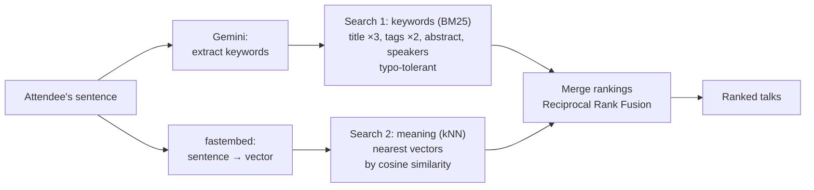
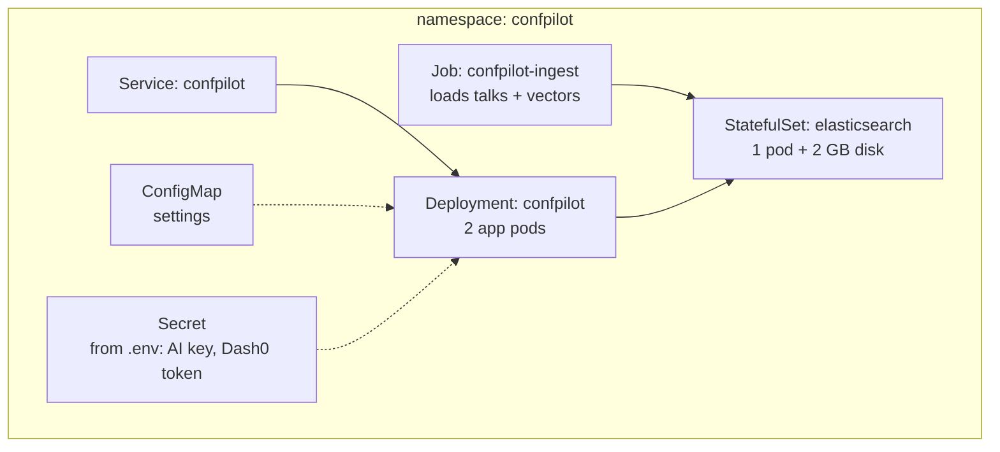
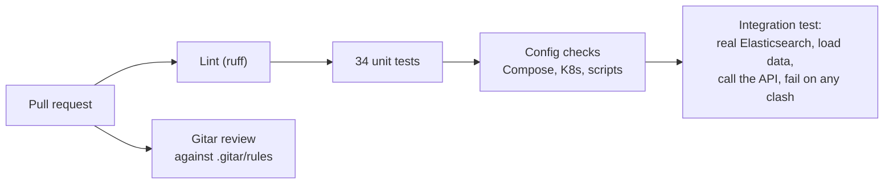

# How ConfPilot uses each tool

This page explains, track by track, **what each tool does in ConfPilot, why we chose it, where it is in the
code, and how you can check it yourself.** No setup is needed to read it.

| Tool | Hackathon track | Its job in ConfPilot | In one sentence |
|---|---|---|---|
| **Elasticsearch** | 4. Search & Vector DB | The engine behind every result | Finds the right talks and people by keywords *and* meaning |
| **Dash0** | 2. Observability | The control room | Shows what every request did, how long each step took, and why something broke |
| **Radar** | 3. Kubernetes UI / AI SRE | The cluster doctor | Shows the app running on Kubernetes and diagnoses incidents |
| **Gitar** | 1. AI Code Review | The gatekeeper | Reviews every pull request against our own rules and fixes what breaks them |
| Google Gemini | (supporting) | The writer | Understands requests and writes the explanations; the app works without it |

---

## The big picture

```mermaid
flowchart LR
    U([Attendee:<br/>"SRE into eBPF..."]) --> APP

    subgraph K8S["Kubernetes cluster (watched by Radar)"]
        APP["ConfPilot app<br/>FastAPI, 2 pods"]
        ES[("Elasticsearch<br/>talks + attendees<br/>+ vectors")]
        APP -- "hybrid search<br/>(keywords + meaning)" --> ES
    end

    APP -- "understand + explain" --> AI["Gemini<br/>(with fallbacks)"]
    APP -- "traces, metrics, logs<br/>(OpenTelemetry)" --> D0["Dash0"]

    DEV([Developer]) -- "pull request" --> GH["GitHub"]
    GH -- "review against<br/>.gitar/rules" --> GITAR["Gitar"]
    GH -- "CI: lint, tests,<br/>real Elasticsearch" --> CI["GitHub Actions"]
```

**One request, start to finish**

1. An attendee types one sentence about themselves.
2. **Gemini** turns it into search keywords and a level (beginner / advanced).
3. **Elasticsearch** runs two searches at once: keywords against the talk text, and the attendee's own sentence
   against the talk *meanings* (vectors). The two rankings are merged.
4. The planner picks the best talk in each time slot, never two at once.
5. **Gemini** writes a one-line reason for each talk. Meanwhile, **Elasticsearch** finds similar attendees.
6. Every step above is recorded and sent to **Dash0**.
7. The app itself runs on **Kubernetes**, which **Radar** watches.
8. Every code change goes through **Gitar** and CI before it reaches `main`.

---

## 1. Elasticsearch: the search engine (Track 4)

### What it does here

Elasticsearch is not a side feature: **every agenda, every chat answer and every "people to meet" list comes from
it.** It stores 165 talks and 60 attendees, and for each one it stores both the text and a *vector*, a list of 384
numbers that captures the meaning of the text.

### How we use it

**Two indices** (like tables), created in [`app/search.py`](app/search.py) by `ingest()`:

| Index | Fields | Used for |
|---|---|---|
| `talks` | title, abstract, speakers, track, level, tags, room, start/end times, **embedding** (384-dim vector, cosine similarity) | Finding talks |
| `attendees` | name, role, company, "what I'm working on", interests, **embedding** | Finding people to meet |

The vectors come from [fastembed](https://github.com/qdrant/fastembed) (`BAAI/bge-small-en-v1.5`), a small model
that runs on the CPU inside our app. No API key, no cost. See [`app/embeddings.py`](app/embeddings.py).

**Hybrid search**, in `hybrid_search_talks()`, runs two searches and merges them:



- **Search 1, keywords (BM25):** a `multi_match` query over title (3× weight), tags (2×), abstract and speakers,
  with `fuzziness: AUTO` so typos still match.
- **Search 2, meaning (kNN):** finds the talks whose vectors are closest to the vector of the attendee's sentence.
- **Merging, Reciprocal Rank Fusion:** a talk's score is `1/(60 + rank)` in each list, added up. Talks that both
  searches like rise to the top. We do this merge in Python (`rrf()`), so it works on Elasticsearch's **free
  license**.
- **Filters:** day and level filters are applied inside both searches, so results always respect them.

**Other uses of Elasticsearch:**

| Feature | How | Function |
|---|---|---|
| People to meet | kNN search over the `attendees` index with the attendee's sentence | `similar_people()` |
| Day / level / track chips in the UI | Aggregations (`terms`, `date_histogram`) | `facets()` |
| Loading talks for the chat and the calendar file | Multi-get by id | `get_talks()` |
| Health checks | `ping` + index exists | `/readyz` in [`app/main.py`](app/main.py) |

### Why it matters

Keyword search alone misses talks that use different words. Vector search alone misses exact names like
"Kyverno" or "eBPF". Together they get both. **Example:** *"How can we save money and help the planet?"* shares
no words with any talk, yet the agenda comes back as FinOps, autoscaling and carbon-footprint talks.

### How to check it

- On every talk card, the **Keyword #** and **Meaning #** badges show the talk's rank in each search, and the
  **Score** is the merged RRF score.
- `POST /api/search` returns raw results, with a `matched_by` field such as `["keyword#3", "semantic#1"]`.
- The CI integration test starts a real Elasticsearch, loads the data and runs a search on every push
  ([workflow](.github/workflows/ci.yml)).

---

## 2. Dash0: observability (Track 2)

### What it does here

Dash0 is where we **see inside the running app**: every request, every step, every error. The app sends three
kinds of data to Dash0 using **OpenTelemetry**, the open standard for this:

| Signal | What it is | Example in ConfPilot |
|---|---|---|
| **Traces** | The timeline of one request, broken into steps (spans) | `POST /api/plan` → `understand` → `hybrid_search` → `embed_query` → Elasticsearch calls → `plan` → `explain` |
| **Metrics** | Numbers over time | Search latency, AI calls by outcome, how often the AI fell back to rules |
| **Logs** | Text messages, linked to their trace | "Slow request /api/plan took 3064 ms", crash stack traces |

### How we use it

Everything is set up in [`app/telemetry.py`](app/telemetry.py):

- **Export:** the OpenTelemetry SDK sends all three signals over OTLP gRPC to Dash0, authenticated with a token
  (`DASH0_OTLP_ENDPOINT`, `DASH0_AUTH_TOKEN` in `.env`).
- **Automatic instrumentation:** every HTTP request (FastAPI) and every Elasticsearch call becomes a span.
- **Our own spans:** each step of a request is wrapped in `telemetry.step(...)`: `understand`, `hybrid_search`,
  `embed_query`, `plan`, `explain`, `people` and, for chat, `load_agenda`, `search_and_edit`, `reply`.
- **Our own metrics:**

  | Metric | Tells you |
  |---|---|
  | `confpilot.search.duration` | How long hybrid search takes |
  | `confpilot.search.results` | How many talks each search returns |
  | `confpilot.llm.calls` | AI calls, by model and outcome: `ok`, `busy`, `retired`, `rejected`, `error` |
  | `confpilot.llm.duration` | How long AI calls take, by model |
  | `confpilot.ai.fallbacks` | How often the app answered with rules because the AI failed, and why |

- **Context on every signal:** service name and version, environment, and on Kubernetes the pod, namespace and
  node, so a Dash0 alert points at the exact pod.

### Built-in incidents for Dash0's AI agent

To show Dash0 finding problems, the app can break itself on purpose ([`app/chaos.py`](app/chaos.py),
[`scripts/chaos.sh`](scripts/chaos.sh)). Each fault leaves a different trail:

| Command | What breaks | What Dash0 shows |
|---|---|---|
| `scripts/chaos.sh slow` | Searches take 3 extra seconds | Traces where `embed_query` takes the time; "Slow request" warnings |
| `scripts/chaos.sh ai` | The AI provider times out | `confpilot.ai.fallbacks` rises; AI calls marked `busy`; error logs naming the timeout |
| `scripts/chaos.sh baddata` | 40% of plans fail with HTTP 500 | `KeyError` stack traces pointing at a talk record with no start time |
| `scripts/chaos.sh off` | Back to normal | |

[`scripts/load.py`](scripts/load.py) sends realistic traffic, so the dashboards always have data.

### Why it matters

When the demo is slow or the AI misbehaves, Dash0 answers *which step*, *which pod* and *why*, without guessing.

---

## 3. Radar: Kubernetes and AI SRE (Track 3)

### What it does here

ConfPilot runs on **Kubernetes**, and [Radar](https://github.com/skyhook-io/radar) is the open-source Kubernetes
UI we use to watch it. Radar shows the pods, their health and what changed, and its **AI SRE** (also available to
coding agents through Radar's built-in MCP server) explains the root cause when something breaks.

### How we use it

**What runs on the cluster**, from [`k8s/confpilot.yaml`](k8s/confpilot.yaml):



- **Health checks:** `/readyz` only answers "ready" when Elasticsearch is reachable and the talks are loaded, so
  Kubernetes stops sending traffic to a pod that can't search. `/healthz` keeps pods alive.
- **Resource limits:** memory limits on every container, so a runaway pod is contained.
- **Pod identity:** each pod's name, namespace and node are passed in and attached to its Dash0 telemetry.

**One script runs it all**, [`scripts/k8s.sh`](scripts/k8s.sh):
`up` builds the image, loads it into the cluster, creates the Secret from `.env`, deploys, loads the data and waits
until healthy. `open` opens the app. `status` shows pods and events.

### Built-in incidents for Radar's AI SRE

| Command | What happens | What Radar shows |
|---|---|---|
| `scripts/k8s.sh break oom` | A "deploy" cuts the memory limit | New pods OOMKilled and restarting; the rollout stalls while old pods keep serving; the limit change in the timeline |
| `scripts/k8s.sh break es-down` | Elasticsearch scaled to 0 | App pods NotReady; readiness failures |
| `scripts/k8s.sh break bad-config` | A config change points at a host that doesn't exist | New pods NotReady with connection errors; the rollout stalls |
| `scripts/k8s.sh break bad-image` | A deploy uses an image tag that doesn't exist | New pods stuck pulling the image; the rollout stalls |
| `scripts/k8s.sh break ai-outage` | The AI provider times out | Pods healthy but degraded (also visible in Dash0) |
| `scripts/k8s.sh break bad-data` | A corrupt record crashes 40% of requests | Error logs and 500s from healthy-looking pods |
| `scripts/k8s.sh fix` | Undo everything | Everything back to green |

### Why it matters

These are the incidents real teams hit. Radar turns "the deploy is stuck" into "this change cut the memory limit,
so the new pods are being OOM-killed". Kubernetes keeps the old pods serving meanwhile, which Radar also shows.

---

## 4. Gitar: AI code review (Track 1)

### What it does here

Gitar reviews every pull request **against rules we wrote for this project**, explains failing CI, and can commit
fixes. Together with CI, it keeps broken code out of `main`.

### How we use it

**Our rules**, in [`.gitar/rules/`](.gitar/rules/). Each is a short Markdown file saying *when* the rule applies
and *what* to check:

| Rule | What Gitar enforces | Why it matters for ConfPilot |
|---|---|---|
| `ai-calls-need-fallback` | Every AI call has a rule-based fallback; AI output is validated | The app must keep working when Gemini is down |
| `agenda-stays-clash-free` | Code that edits the agenda checks for overlaps and has a test | "No clashes" is the product's core promise |
| `elasticsearch-basic-license` | Only free-license Elasticsearch features | Anyone can run it on a stock Elasticsearch |
| `telemetry-conventions` | New steps are traced; metric labels stay low-cardinality; no secrets in logs | Keeps Dash0 data useful and affordable |
| `no-secrets` | No API keys or tokens committed | Keys stay in `.env` only |

**CI on every push and pull request**, in [`.github/workflows/ci.yml`](.github/workflows/ci.yml):



### The evidence: pull request #3

[Pull request #3](https://github.com/vuppalasaiganesh/ConfPilot/pull/3) looks like a harmless feature (AI
summaries for talks and a planner "speed-up") but quietly breaks our rules. What happened:

1. **CI failed:** the planner test caught two talks at the same time.
2. **Gitar blocked it** with 4 findings, failing 3 of our 5 rules:
   - 🚨 the planner only checked the last picked talk, so clashes got through;
   - ⚠️ the new AI call had no fallback;
   - ⚠️ an unknown talk ID returned error 500 instead of 404, a bug we **didn't** plant;
   - 💡 a metric labelled with talk IDs would create unbounded data series.
3. **Gitar explained the failing CI**, pointing at the exact line.
4. **Gitar's fixes were applied** and every check turned green.

A second completed review is on [pull request #2](https://github.com/vuppalasaiganesh/ConfPilot/pull/2).

### Why it matters

The rules encode what makes ConfPilot work: graceful AI failure, no clashes, affordable telemetry. Gitar checks
them on every change, so they stay true as the code grows.

---

## 5. The AI (supporting role)

Google Gemini (free tier) does three jobs, all in [`app/llm.py`](app/llm.py) and [`app/chat.py`](app/chat.py):

| Job | Example |
|---|---|
| Understand the request | "Student, new to cloud native" → keywords + Beginner level |
| Explain the agenda | A one-line reason per talk, a summary and tips |
| Run the chat | "swap day 2 for AI talks" → replace mode, day 2, query "AI" |

**It's built to fail safely:**
- if the main model is busy, a **backup model** answers;
- if a model is retired, the app **switches to the replacement** the provider names;
- if every AI call fails, the app **answers with rules** and the page explains why.

Any OpenAI-compatible provider works (Gemini, Groq, xAI, OpenAI) by changing three lines in `.env`.

---

## Where to look

| To check… | Open |
|---|---|
| Hybrid search code | [`app/search.py`](app/search.py) |
| Telemetry code | [`app/telemetry.py`](app/telemetry.py), [`app/chaos.py`](app/chaos.py) |
| Kubernetes setup | [`k8s/confpilot.yaml`](k8s/confpilot.yaml), [`scripts/k8s.sh`](scripts/k8s.sh) |
| Gitar rules and review | [`.gitar/rules/`](.gitar/rules/), [pull request #3](https://github.com/vuppalasaiganesh/ConfPilot/pull/3) |
| CI results | [GitHub Actions](https://github.com/vuppalasaiganesh/ConfPilot/actions) |
| Everything at once | `scripts/validate.sh` checks all four tracks and prints PASS / WARN / FAIL |
